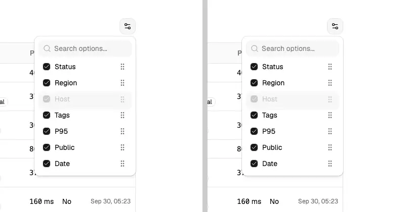
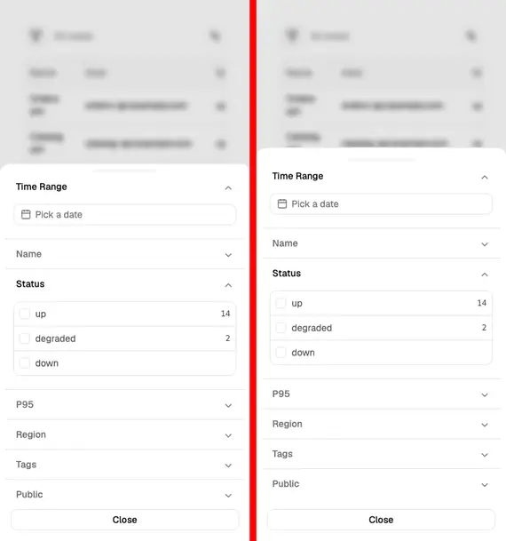
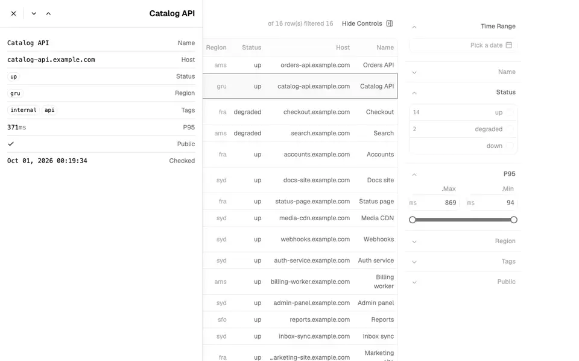
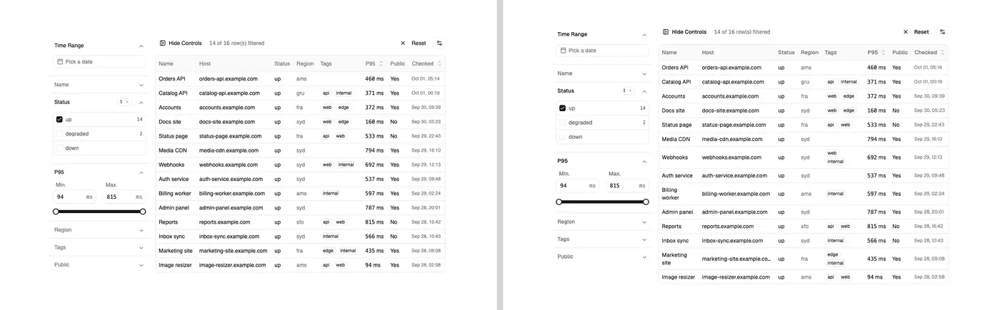
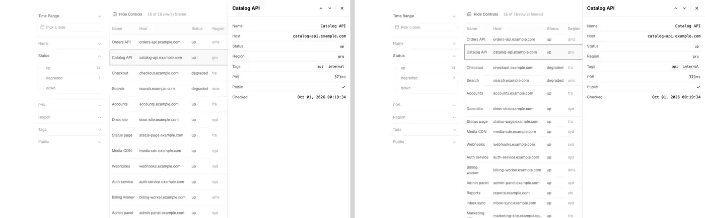
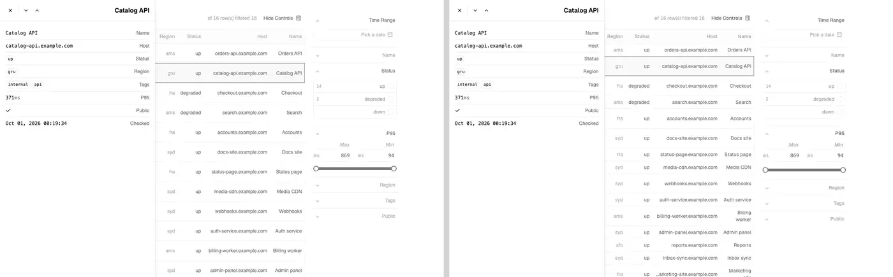

# data-table: primitive variants

Evidence for the non-default variants of `data-table`, `data-table-filter-command`
and `data-table-sheet`. The Radix variant's fidelity is in [fidelity.md](fidelity.md).

## Base UI

Items: `data-table-base-{lucide,phosphor}`, `data-table-filter-command-base-{lucide,phosphor}`,
`data-table-sheet-base-{lucide,phosphor}` (`beta`). Upstream installs its blocks into
shadcn's Base UI style (`shadcn init -d`), so this is a faithful variant: the
`src/base/` overlays replace the Radix files with `@base-ui/react` parts and the
base-nova `ui` API (`render` instead of `asChild`).

| Overlay | Built on |
| --- | --- |
| `custom/accordion.tsx` | `accordion` (`multiple`; the Radix-style `type="multiple"` and `data-state` are kept, and the panel aliases `--accordion-panel-height` to the keyframes' height variable) |
| `custom/slider.tsx` | `slider` (Root, Control, Track, Indicator, Thumb; `thumbAlignment="edge"`; `DirectionProvider` follows `dir`; thumbs named Minimum and Maximum) |
| `custom/sortable.tsx` | `useRender` + `mergeProps` (accepts `asChild` and `render`); dnd-kit's live region is portaled to `<body>` |
| `custom/sheet.tsx` | `dialog` (Backdrop, Popup, Close; same tw-animate-css keyframes on `data-open`/`data-closed`; ArrowUp/ArrowDown bubble out of the popup as on Radix) |
| date picker, drawer, reset buttons, toolbar, floating bar, view options, sheet details, text tooltip, hover-card timestamp | `render` on the triggers; `nativeButton={false}` for the filter reset chip; the preview card's delays on its trigger |
| `data-table-sheet-row-action.tsx` | the shared file plus `preventBaseUIHandler()` on ArrowUp/ArrowDown, so the menu does not open on arrows and row navigation keeps working |

How it was checked: a local Vite + React 19 + Tailwind v4 app made with
`shadcn init -t vite -b base -p nova` (style `base-nova`, Lucide), the three
`*-base-lucide` items installed with `shadcn add` from a local registry (the
filter-command and sheet items pulled `@designfrom/data-table-base-lucide`
through their registry dependency), and a twin app made with `-b radix -p nova`
holding the `*-radix-lucide` items, so the two differ only in primitives.

- `tsc --noEmit`: clean for the Lucide and the Phosphor items (with the
  template's `noUnusedLocals`/`noUnusedParameters` off; the remaining unused
  symbols are upstream's, identical in every variant).
- Behavior, scripted in Playwright and identical on both apps: filters
  (checkbox by label, input, slider by keyboard and by drag, reset chip,
  reset button and its tooltip), accordion by mouse and Enter, date range
  popover (preset shortcut, Escape returns focus to the trigger), view options
  (visibility toggle, drag sorting by mouse and by keyboard reorders the
  table), command filter (`status:degraded`), sheet (opens on a row, initial
  focus on Close, ArrowDown moves to the next row also from a field's menu
  trigger, Enter opens the field menu, Escape closes the menu then the sheet,
  focus returns to the current row, focus stays trapped), drawer at 375 px
  (opens, named "Filters", closes, focus returns to its trigger).
- RTL (`dir="rtl"` on `<html>`): sheet at the inline end (x = 0), slider
  mirrored (minimum thumb on the right). Reduced motion: accordion and sheet
  `animation-name: none`.
- axe (`wcag2a/aa, 21a/aa, 22aa, best-practice`), light and dark, LTR and RTL,
  1280 and 375: 0 violations for the table, the filter drawer, the open view
  options with the slider, the date popover (in the drawer at 375), the
  command and the open sheet, with the Design From theme tokens. Residual:
  `region` (moderate) for the sheet's open field menu, because the ui kit
  portals the menu outside the page landmarks; the Radix twin reports the
  same. With the stock neutral theme the only extra findings are the
  theme-level contrast ones already recorded for Radix (muted `kbd`, muted
  text on a selected row).

Pixel diff, Base UI app against the Radix app (same data, 1280x800 unless
noted, pixelmatch threshold 0.1):

| State | Differing px |
| --- | --- |
| table, command open, sheet open, sheet menu, view options, view options dragging, date popover, slider, RTL slider, RTL sheet, table at 375 | 0 (0.0000%) |
| filters active | 135 (0.0132%) |
| reset tooltip | 1260 (0.1230%) |
| filter drawer at 375 | 8117 (2.6657%) |

What differs comes from the base-nova `ui` primitives, not from the block:
the tooltip sits a few pixels further from its trigger (base-nova's
`TooltipContent` positioning), a mouse drag of a slider thumb lands a step or
two away (Base UI maps pointer position with `thumbAlignment="edge"`
slightly differently), and base-nova's `ui/drawer` is Base UI's drawer, not
Vaul: its default height and footer padding differ. The block asks it for the
swipe handle (`showSwipeHandle`) so it keeps Vaul's handle. One difference was
ours and is fixed: the slider control was 8 px taller than Radix's.

## React Aria

Items: `data-table-aria-{lucide,phosphor}`, `data-table-filter-command-aria-{lucide,phosphor}`,
`data-table-sheet-aria-{lucide,phosphor}` (`beta`). They target shadcn's React Aria
style (`shadcn init -b aria`, `aria-nova`), whose `ui` kit follows React Aria
Components: a `TooltipTrigger` wraps its trigger and `Tooltip`, `PopoverTrigger`
is a `DialogTrigger`, `DropdownMenuTrigger` is a `MenuTrigger` around the trigger
and the menu, `ui/command` is an `Autocomplete` around a `Menu` (no cmdk), and
`ui/calendar` is React Aria's `RangeCalendar`. The `src/aria/` overlays import
no headless library but `react-aria-components` (plus `@internationalized/date`
for calendar dates). `aria-nova`'s own `ui/drawer` is Base UI's drawer; that is
shadcn's file, not the block's.

| Overlay | Built on |
| --- | --- |
| `custom/accordion.tsx` | `DisclosureGroup`, `Disclosure`, `Heading` + `Button slot="trigger"`, `DisclosurePanel`; Radix-style props (`type`, `value`, `defaultValue`, `onValueChange`) and `data-state` kept; height animates on `--disclosure-panel-height` (200 ms ease-out); closed panels are `hidden="until-found"` |
| `custom/slider.tsx` | `Slider`, `SliderTrack`, `SliderFill`, `SliderThumb`; the wrapper keeps `value`/`min`/`max`/`onValueChange`; thumbs run on a track inset by half a thumb so they sit where Radix draws them; thumbs named Minimum and Maximum |
| `custom/follow-direction.tsx` (new) | `I18nProvider`/`useLocale`/`isRTL`: React Aria reads direction from its locale, so the slider and the date picker follow `dir` on `<html>` when the two disagree |
| `custom/sortable.tsx` | a local slot with Radix `Slot` merge rules (React Aria's `mergeProps` is not exported by `react-aria-components`); the drag handle is a native button with `buttonVariants`, keeps pointer and drag keys away from an enclosing collection item and hands the drag keys to dnd-kit's document listener |
| `custom/date-picker-with-range.tsx`, `data-table-filter-timerange.tsx` | `PopoverTrigger` + `Popover` (the popover is the dialog), `RangeCalendar` with `@internationalized/date`, `Select` with `selectedKey`; a local `DateRange` type, so nothing imports react-day-picker |
| `data-table-view-options.tsx` | `ui/command` as `Autocomplete` + `Menu`, `shouldCloseOnSelect={false}`; the sortable row sits inside each menu item (a collection item is rendered apart from its wrappers, so a wrapping slot never gets the ref) |
| toolbar, reset button, floating bar, filter drawer | `TooltipTrigger` around `Button` + `Tooltip`; `onPress`; physical placements from `dir`; the drawer is opened from state and keeps its swipe handle |
| filter reset chip, refresh button, `data-table-infinite.tsx`, checkbox filter | the chip is a `role="button"` element with the button look that stops `pointerdown`/`keydown` from reaching the accordion trigger; `isDisabled`/`onPress`; `Checkbox` with `isSelected`/`onChange` |
| `custom/sheet.tsx`, sheet details | `ModalOverlay`, `Modal`, `Dialog` (title slot names it, description wired by id); `data-entering`/`data-exiting` drive the same tw-animate-css slides; close is `Button slot="close"` |
| sheet row action | `MenuTrigger` + `Pressable` around the field button; ArrowUp/ArrowDown are cancelled in the capture phase so they move between rows instead of opening the menu; items use `onAction` |
| text tooltip, timestamp card | the project's `Tooltip` and `HoverCard` popover opened from hover through `triggerRef`/`isOpen` (see below) |
| filter command | `Autocomplete` with `inputValue`/`onInputChange`, a `filter` that runs upstream's `getFilterValue` on each item key, `TextField` + `Input`, `onAction`, `renderEmptyState`; only a real blur closes it (React Aria's virtual focus dispatches a blur on the field) |

Honest equivalents, not one-to-one: the timestamp card and the tooltip on
truncated text open on hover only. `aria-nova`'s `ui/hover-card` is React Aria's
`PreviewTrigger`, which (like `TooltipTrigger`) makes its trigger focusable, and
these triggers sit inside the sheet's field buttons, where a focusable
descendant is invalid HTML. The Radix variant behaves the same (hover only on a
non-focusable `div`); the full text and values stay in the DOM.

How it was checked: a local Vite + React 19 + Tailwind v4 app made with
`shadcn init -t vite -b aria -p nova` (style `aria-nova`, Lucide), the three
`*-aria-lucide` items installed with `shadcn add` from the exported JSON (the
sheet and command items with the `@designfrom` dependency dropped, since the
data-table item was installed first; later exports were refreshed by writing
the item files to their targets), next to a copy of the Base UI pass's
radix-nova twin with the `*-radix-lucide` items.

- `tsc --noEmit`: clean for the Lucide and the Phosphor items (template's
  `noUnusedLocals`/`noUnusedParameters` off; the remaining unused symbols are
  upstream's, the same in every variant).
- Behavior, scripted in Playwright: checkbox filter by label, reset chip (resets
  without toggling the section), accordion by mouse and keyboard, slider by
  keyboard (PageUp) and by mouse drag, date range (preset click and shortcut,
  two-day pick, ArrowLeft moves a day back in LTR and forward in RTL, Escape
  closes and returns focus to the trigger), view options (search, Enter toggles
  and the popover stays open, drag sorting by mouse and by keyboard reorders the
  table, focus returns to View), command (`sta` + Enter gives `status:`,
  ArrowDown + Enter gives `status:degraded `, two rows; Escape closes; a saved
  suggestion's remove button removes it without picking it), sheet (opens on a
  row, named by the row, initial focus on Close, ArrowDown moves to the next row
  also from a field button without opening its menu, Enter opens the field menu
  with focus on its first item, Escape closes the menu then the sheet, focus
  returns to the current row), drawer at 375 (opens, closes, focus returns to
  its toggle), tooltips (hover, placement right of Hide Controls), timestamp
  card (opens on hover, stays while the pointer is in it, closes on leave). No
  console errors.
- RTL (`dir="rtl"`, browser locale English): sheet at the inline end (x = 0),
  slider mirrored (minimum thumb on the right, ArrowLeft raises it), date
  popover aligned to the trigger's inline start, field menu opens toward the
  table. With no `lang` on the page, the fallback locale for right to left is
  Arabic, so the calendar's month and day names are Arabic there.
- Reduced motion: no `data-entering`/`data-exiting` animation on the sheet and
  its overlay (`animation-name: none`; with motion they run `enter`/`exit`), and
  the accordion opens without a height transition.
- axe (`wcag2a/aa, 21a/aa, 22aa, best-practice`), light and dark, LTR and RTL,
  1280 and 375: 0 violations for the three demos, the open sheet, the open
  field menu, the date popover (in the drawer at 375), the view options, the
  drawer, and the command (the command with the Design From theme tokens; with
  the stock neutral theme, light mode reports the theme-level contrast already
  recorded for Radix: muted `kbd` and muted counts on a highlighted item).
  Pre-existing in every variant, Radix included: with a filter set, the reset
  chip inside the accordion trigger is `nested-interactive`, and its 20 px
  height fails `target-size`.

Differences from the Radix demos (images: Radix left, React Aria right): the
table and sheet render the same parts; a few columns are 1 to 5 px wider or
narrower because the column header buttons measure differently in the two
shadcn styles' kits (same classes), which rewraps two cells; `aria-nova`'s
calendar abbreviates weekdays to one letter and its drawer is Base UI's (the
block asks for the swipe handle). Picking days in React Aria's range calendar
sets the filter once both ends are picked (react-day-picker filters on the
first click). Clicking a drag handle no longer toggles its column.

